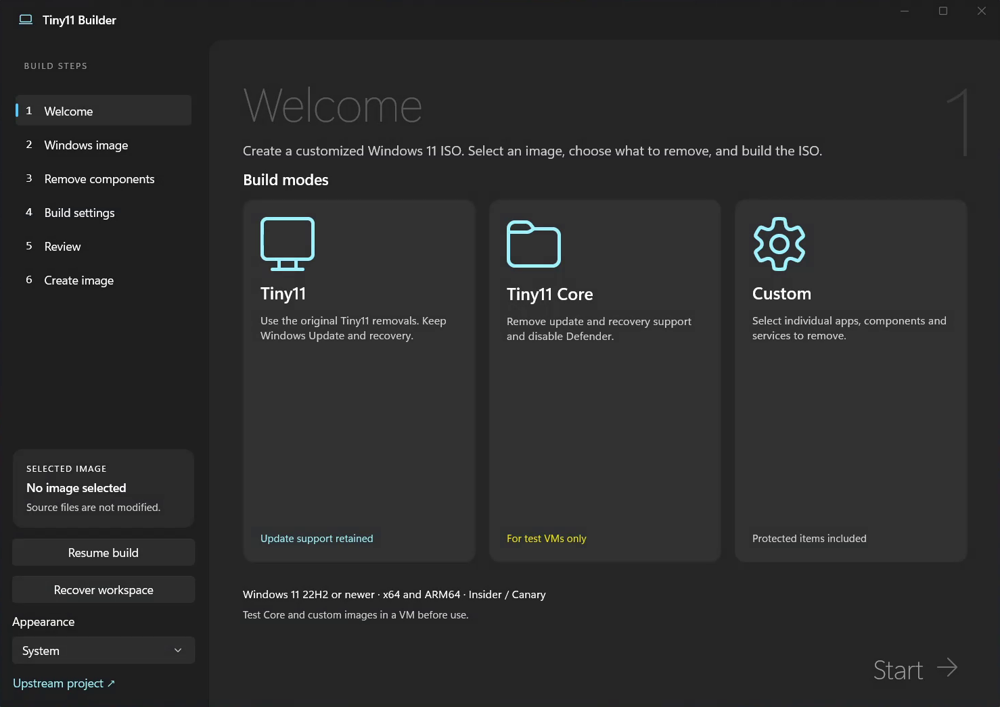
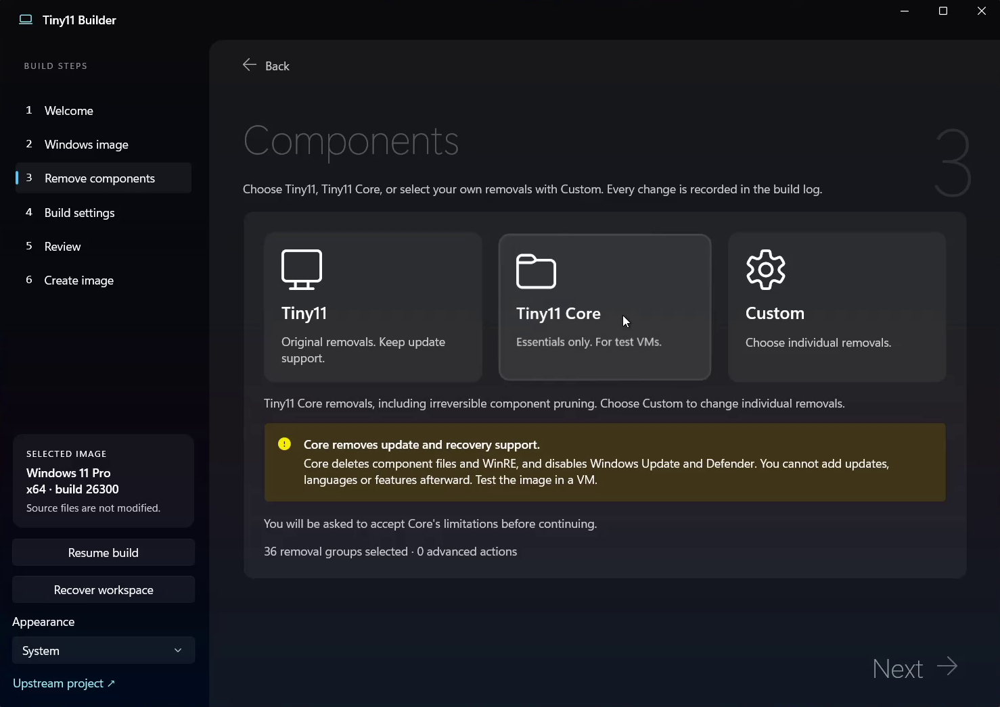
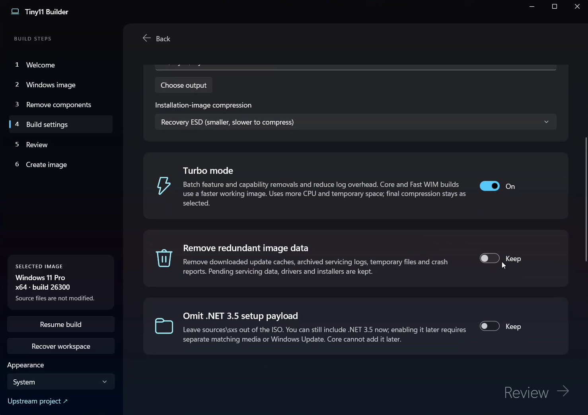

# Tiny11 Builder（中文版）

用原生 WinUI 应用制作更精简的 Windows 11 ISO。下载微软官方 Windows 映像，
或使用你自己的映像，选择要移除的内容，然后生成 ISO。

> 本仓库是 [ntdevlabs/tiny11builder](https://github.com/ntdevlabs/tiny11builder) 的
> **简体中文汉化版**：界面、提示、错误信息与文档均已汉化，构建与打包流程与原版一致。

## 下载

[**获取最新版本**](https://github.com/ntdevlabs/tiny11builder/releases/latest)

Intel / AMD 电脑请选择 **x64**，Windows on ARM 设备请选择 **ARM64**。
解压整个 ZIP 后打开 `Tiny11Builder.exe`。运行时需要管理员授权。

## 选择构建模式

| 模式 | 作用 |
| --- | --- |
| Tiny11 | 移除内置应用和不需要的功能，保留更新、Defender 和恢复环境。 |
| Tiny11 Core | 进一步精简：移除服务堆栈维护与恢复支持，并关闭 Defender。 |
| 自定义 | 自行选择要移除或保留的应用、组件、功能和服务。 |

极速模式可加快映像处理。在映像提交或压缩之后被中断的构建，可以从已保存的进度继续。
Core 模式与组件库移除会自动使用旧版 Windows 安装程序。

**Core 模式无法更新和服务堆栈维护。受保护的自定义移除可能导致 Windows 无法使用。
安装前请先在虚拟机中测试生成的 ISO。**

## 视频

[**在 YouTube 上观看**](https://youtu.be/LfEWIz5mQ8A)

## 界面截图

### 欢迎页

### 组件选择

### 构建设置

## 更多信息

[用法、兼容性与构建说明](docs/usage.md) ·
[署名与分发说明](NOTICE.md)

本仓库中仍然保留着原始的 PowerShell 构建脚本。

## 支持本项目

[GitHub Sponsors](https://github.com/sponsors/ntdevlabs) ·
[Patreon](https://www.patreon.com/ntdev) ·
[PayPal](https://paypal.me/ntdev2) ·
[Ko-fi](https://ko-fi.com/ntdev)
